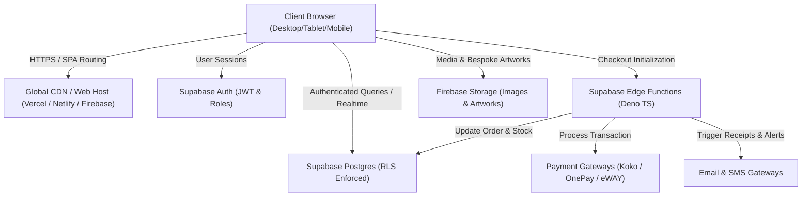

# VALKNUT Official — Production Handover & Operations Guide

**Application:** VALKNUT Official Dark Luxury Streetwear  
**Production URL:** [https://valknutofficial.com/](https://valknutofficial.com/)  
**Primary Market:** Sri Lanka (Islandwide) & International  
**Architecture:** React 19 + TypeScript + Vite + Tailwind CSS + Supabase (Database/Auth/RLS/Edge Functions) + Firebase Storage  
**Document Version:** 1.0.0 (Production Release)

---

## 1. System Architecture Overview



---

## 2. Repository & Directory Structure

```
valknut/
├── public/
│   ├── _redirects              # Netlify/Cloudflare Pages SPA rewrite
│   ├── robots.txt              # Search engine crawling rules
│   ├── sitemap.xml             # XML sitemap with image extensions
│   ├── favicon.svg             # Golden Valknut vector favicon
│   └── icons.svg               # SVG icons sheet
├── src/
│   ├── components/
│   │   ├── account/            # Customer Portal (Orders, Profile, Addresses)
│   │   ├── admin/              # Executive Dashboard (Inventory, Orders, Analytics)
│   │   ├── cart/               # Cart Drawer & Cart Full Page
│   │   ├── checkout/           # Multi-step One-Page Checkout
│   │   ├── common/             # SEOHead, Toast notifications, Modal frames
│   │   ├── customStudio/       # Bespoke 2D Layered Studio CAD Customizer
│   │   ├── home/               # 13 Editorial Homepage Sections
│   │   ├── layout/             # Responsive Header, Navbar, Footer
│   │   ├── pages/              # Dedicated SEO, Lookbook, Story, Size Guide
│   │   ├── shop/               # Catalog, Faceted Filters, Product Details Gallery
│   │   └── ui/                 # Atomic Button, Badge, Modal, Price, Inputs
│   ├── context/                # StoreContext (Global Cart, Products, Auth state)
│   ├── data/                   # Initial Catalog, Coupons, Sample Orders
│   ├── lib/                    # Supabase & Firebase client initializers
│   ├── services/               # API Services (Order, Payment, Auth, Email, SMS)
│   ├── types/                  # Strict TypeScript domain interfaces
│   └── utils/                  # SEO Structured Data, Security Sanitizers
├── supabase/
│   └── functions/              # Deno Edge Functions
│       ├── payment-initiate/   # Gateway session initialization
│       ├── payment-webhook/    # Webhook signature verification & status update
│       ├── send-email/         # Transactional email dispatch
│       └── send-sms/           # Sri Lankan SMS gateway dispatch
├── firebase.json               # Firebase Hosting & Storage rules config
├── storage.rules               # Firebase Storage bucket security rules
├── supabase_schema.sql         # Supabase PostgreSQL schema with RLS & Indexes
├── vercel.json                 # Vercel SPA rewrites & security headers
├── vite.config.ts              # Vite production bundle configuration
└── package.json
```

---

## 3. Environment Variables Specification

Create a `.env` file in the root directory:

```env
# Application
VITE_APP_ENV=production
VITE_APP_URL=https://valknutofficial.com

# Supabase (Public Client)
VITE_SUPABASE_URL=https://your-project.supabase.co
VITE_SUPABASE_ANON_KEY=your-anon-public-key

# Firebase Storage (Public Client)
VITE_FIREBASE_API_KEY=your-api-key
VITE_FIREBASE_AUTH_DOMAIN=your-project.firebaseapp.com
VITE_FIREBASE_PROJECT_ID=your-project-id
VITE_FIREBASE_STORAGE_BUCKET=your-project.appspot.com
VITE_FIREBASE_MESSAGING_SENDER_ID=your-sender-id
VITE_FIREBASE_APP_ID=your-app-id

# Payment Gateways (Public Merchant IDs)
VITE_KOKO_MERCHANT_ID=your-koko-merchant-id
VITE_ONEPAY_APP_ID=your-onepay-app-id
VITE_EWAY_PUBLIC_API_KEY=your-eway-api-key
```

### Supabase Edge Function Secrets (Set in Supabase Dashboard):
- `SUPABASE_SERVICE_ROLE_KEY`
- `KOKO_SECRET_KEY` / `KOKO_API_KEY`
- `ONEPAY_HASH_SALT` / `ONEPAY_APP_TOKEN`
- `EWAY_API_PASSWORD`
- `RESEND_API_KEY` or `SENDGRID_API_KEY`
- `SMS_GATEWAY_API_TOKEN`

---

## 4. Database Setup & Migration (Supabase)

1. Open **Supabase Dashboard** > **SQL Editor**.
2. Copy and execute the contents of [`supabase_schema.sql`](file:///d:/youDigit%20IT/valknut/valknut/supabase_schema.sql).
3. The script will automatically:
   - Create tables: `categories`, `products`, `product_variants`, `coupons`, `customer_profiles`, `orders`, `order_items`.
   - Enable **Row Level Security (RLS)** on all tables.
   - Set up security policies permitting public catalog reads, customer self-orders, and admin-only privilege gates.
   - Build B-Tree performance indexes on slugs, categories, SKUs, and order numbers.

---

## 5. Firebase Storage Setup

1. Open **Firebase Console** > **Storage**.
2. Deploy the [`storage.rules`](file:///d:/youDigit%20IT/valknut/valknut/storage.rules) file using the Firebase CLI:
   ```bash
   firebase deploy --only storage
   ```
3. Folder architecture:
   - `/products/**`: Public read, admin write.
   - `/custom-studio/**`: Public read, customer upload with strict 15MB file size limit and PNG/JPEG/WEBP/SVG validation.

---

## 6. Build & Deployment Commands

```bash
# 1. Install dependencies
npm install

# 2. Local development server (port 5173)
npm run dev

# 3. Production TypeCheck & Build
npm run build

# 4. Preview production build locally
npm run preview
```

### Deploy to Hosting Platforms:
- **Vercel**: Run `vercel --prod` (automatically picks up `vercel.json`).
- **Netlify**: Run `netlify deploy --prod --dir=dist` (uses `public/_redirects`).
- **Firebase Hosting**: Run `firebase deploy --only hosting` (uses `firebase.json`).

---

## 7. Admin Login & Initial Setup

1. Navigate to: `https://valknutofficial.com/#/admin`
2. Authenticate using an email with the `@valknutofficial.com` domain or your configured Supabase admin credentials.
3. In Supabase Auth, assign `app_metadata: { "role": "admin" }` to your user record.
4. Admin features available:
   - **Product Inventory**: Add/edit variants, prices, sizes, and upload Firebase photos.
   - **Order Logistics**: Update status (In Production, Shipped, Delivered), enter Pronto Lanka AWB codes.
   - **Custom Studio Fulfillment**: View and download full-resolution customer artwork files.
   - **Coupons**: Create discount codes and minimum order thresholds.

---

## 8. Customer Support & Contact

- **Brand:** VALKNUT Official Sri Lanka
- **Engineering Support:** youDigit IT (`support@youdigit.lk`)
- **Domain:** `https://valknutofficial.com`
- **Slogan:** *OWN YOUR MIND. CONTROL YOUR WORLD.*
