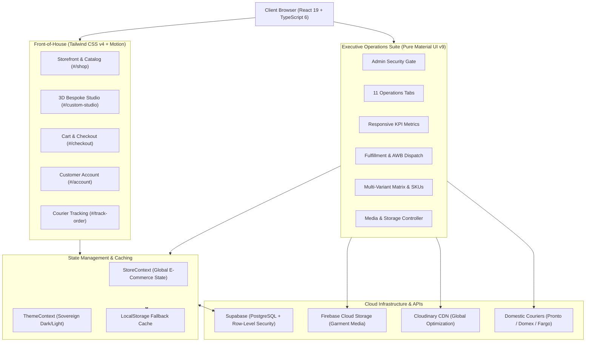

# VALKNUT | Sovereign Luxury Streetwear & Bespoke 3D Studio

<div align="center">


### SOVEREIGN LUXURY HEAVYWEIGHT SILHOUETTES & BESPOKE 3D APPAREL STUDIO


<br/>

**OWN YOUR MIND. CONTROL YOUR WORLD.**  
*Sri Lanka's premier sovereign luxury streetwear house, combining dark sovereign aesthetics, heavyweight combed loopback cotton garments (320–480 GSM), an interactive 3D Bespoke Studio, and an Executive Suite Admin Dashboard.*

[Explore Storefront](http://localhost:5173/#/) • [3D Bespoke Studio](http://localhost:5173/#/custom-studio) • [Executive Admin Suite](http://localhost:5173/#/admin) • [Documentation](#table-of-contents)

</div>

---

## Table of Contents

- [Overview](#overview)
- [System Architecture](#system-architecture)
- [Core Modules & Capabilities](#core-modules--capabilities)
  - [1. Executive Suite Admin Dashboard (MUI v9)](#1-executive-suite-admin-dashboard-mui-v9)
  - [2. Interactive 3D Bespoke Apparel Studio](#2-interactive-3d-bespoke-apparel-studio)
  - [3. Sovereign Storefront & Editorial Drops Catalog](#3-sovereign-storefront--editorial-drops-catalog)
  - [4. Customer Account Portal & Authentication](#4-customer-account-portal--authentication)
  - [5. Logistics & Domestic Courier Tracking](#5-logistics--domestic-courier-tracking)
  - [6. Dual-Cloud Zero-Egress Media Pipeline](#6-dual-cloud-zero-egress-media-pipeline)
  - [7. SEO Engine & JSON-LD Structured Data](#7-seo-engine--json-ld-structured-data)
- [Technology Stack](#technology-stack)
- [Project Directory Structure](#project-directory-structure)
- [Getting Started & Local Setup](#getting-started--local-setup)
  - [Prerequisites](#prerequisites)
  - [Installation](#installation)
  - [Environment Configuration](#environment-configuration)
  - [Running the Application](#running-the-application)
- [Demonstration & Testing Credentials](#demonstration--testing-credentials)
- [Database Setup & Supabase Schema](#database-setup--supabase-schema)
- [Available Scripts](#available-scripts)
- [Complete Route Directory](#complete-route-directory)
- [Code Quality & Type Safety](#code-quality--type-safety)
- [License & Brand Disclaimer](#license--brand-disclaimer)

---

## Overview

**VALKNUT** is an enterprise-grade luxury e-commerce platform and bespoke garment customization engine engineered for high-performance apparel retail. Developed in Colombo, Sri Lanka, the platform delivers an immersive sovereign dark-luxury experience, bringing together:

1. **A Customer-Facing Digital Flagship**: Seamless collection browsing, multi-attribute filtering, high-resolution product galleries, instant cart management, and multi-gateway checkout (Cash on Delivery, Koko BNPL, Mintpay, OnePay Card).
2. **An Interactive 3D Bespoke Garment Studio**: A real-time apparel customizer allowing patrons to select print placements (Chest, Back, Left Sleeve, Right Sleeve), choose specialized luxury print techniques (3D Puff Rubber, High-Density Screen Print, Metallic Foil / Direct Embroidery), upload high-resolution vector artwork, and preview designs with instant cost estimation in LKR.
3. **An Executive Suite Admin Dashboard**: A responsive back-of-house operations center built exclusively with **Material UI (MUI v9)**, handling real-time revenue analytics, multi-variant inventory control, bespoke commission approvals, AWB courier tracking generation, category taxonomy, promotional coupon engines, and dual-cloud media synchronization.

---

## System Architecture



---

## Core Modules & Capabilities

### 1. Executive Suite Admin Dashboard (MUI v9)
The operations suite was built exclusively using **Material UI (MUI v9)** components (`AppBar`, `Toolbar`, `Tabs`, `Tab`, `Grid`, `Card`, `Table`, `Dialog`, `TextField`, `Select`, `Chip`), adhering to strict responsive design principles (`xs`, `sm`, `md`, `lg`, `xl` breakpoints).

- **Executive KPI Analytics**: Responsive metrics grid displaying Gross Revenue (LKR), Active Orders, Bespoke Commissions, and Low Stock Alerts with percentage trends and dynamic chips.
- **Order Fulfillment Matrix**: Filter orders by status (`PENDING`, `PROCESSING`, `SHIPPED`, `DELIVERED`, `CANCELLED`). Includes detailed customer inspection dialog, status updating, and invoice generation.
- **Bespoke 3D Studio Commissions**: Real-time queue of custom client garments with print placement tags, technique identifiers, high-res canvas previews, and vector download links for manufacturing.
- **Product & Multi-Variant Catalog**:
  - Multi-attribute variant generator (Sizes: `XS`, `S`, `M`, `L`, `XL`, `2XL`, `3XL`).
  - Color hex code swatch selector.
  - Automatic SKU generation with per-variant stock tracking and low-inventory threshold badges.
- **Editorial Drops & Taxonomies**: Independent managers for dynamic categories and seasonal collections.
- **Voucher & Discount Engine**: Percentage or flat LKR coupon generator with usage caps, expiration dates, and minimum order thresholds.
- **Customer Relationship Management**: Customer registry with total spend tracking, order counts, phone contacts, and delivery addresses.
- **Cloud Media Center**: Dual-bucket testing suite for Firebase Storage and Cloudinary CDN credentials, with one-click media synchronization to Supabase.
- **Supabase SQL Verification**: Embedded schema inspection and one-click copy of production SQL setup scripts.

### 2. Interactive 3D Bespoke Apparel Studio
- **Dynamic Garment Canvas**: Client-side interactive canvas featuring front, back, and sleeve views of heavyweight hoodies and tees.
- **Print Placement Selectors**:
  - Chest Crest / Pocket Logo
  - Full Front Center Print
  - Sovereign Back Artwork
  - Left & Right Sleeve Prints
- **Luxury Print Techniques**:
  - *3D Puff Rubber*: High-density raised tactile rubber finish (+LKR 850).
  - *Silkscreen High-Density*: Crisp micro-pigment plastisol print (+LKR 450).
  - *Direct Luxury Embroidery*: 12,000-stitch metallic thread embroidery (+LKR 1,200).
- **Artwork Upload & Vector Engine**: Drag-and-drop file upload supporting high-resolution PNG, SVG, and vector assets.
- **Live Pricing Engine**: Dynamic pricing calculation reflecting fabric base weight, number of print placements, and specialized print finishes.

### 3. Sovereign Storefront & Editorial Drops Catalog
- **Dark Sovereign Aesthetic**: Engineered with rich obsidian tones (`#0a0a0c`), sovereign gold accents (`#D4AF37`), dark graphite cards, and metallic borders.
- **Heavyweight Fabric Standards**: Garments engineered in 240 GSM combed jersey, 320 GSM French Terry, and 480 GSM loopback cotton.
- **Multi-Attribute Filters**: Filter catalog by gender category (`MEN`, `WOMEN`, `ESSENTIALS`), sub-category (`HOODIES`, `TEES`, `BOTTOMS`, `OUTERWEAR`, `ACCESSORIES`), size, collection, and price range.
- **Slide-Out Cart Drawer**: Persistent cart with real-time subtotal calculation, free shipping thresholds, and seamless checkout redirect.
- **Flexible Checkout Flow**: Support for Cash on Delivery (COD), Buy Now Pay Later (Koko BNPL, Mintpay), and OnePay Card Gateway with coupon code verification.

### 4. Customer Account Portal & Authentication
- Built with pure Material UI dialogs and dedicated pages (`/#/account`, `/#/login`, `/#/register`).
- **Client Security**: Secure password hashing with email verification state and demo auto-login helpers.
- **Order Tracking History**: Detailed chronological history of all previous purchases with delivery status chips and item summaries.
- **Address Book**: Save and manage primary delivery addresses across Sri Lankan districts and postal codes.

### 5. Logistics & Domestic Courier Tracking
- Integrated with domestic courier networks: **Pronto Lanka Express**, **Domex**, and **Fargo**.
- Real-time Air Waybill (AWB) consignment generator.
- Public customer tracking portal (`/#/track-order`) with 5-stage visual progress tracker:
  1. *Order Confirmed*
  2. *Quality Checked & Packed*
  3. *Handed to Courier*
  4. *Out for Delivery*
  5. *Successfully Delivered*

### 6. Dual-Cloud Zero-Egress Media Pipeline
- **Firebase Storage**: Direct-to-bucket media uploads bypassing database row size limitations.
- **Cloudinary Global CDN**: Dynamic format conversion (`f_auto`), quality optimization (`q_auto`), and thumbnail resizing for instant page loads.
- **Zero Database Egress**: URLs stored in Supabase PostgreSQL tables; zero binary data stored in database rows.

### 7. SEO Engine & JSON-LD Structured Data
- Automated meta tag generation with OpenGraph and Twitter cards.
- **Schema.org Structured Data** injected automatically:
  - `Organization` (Brand name, logo, contact points, sovereign social channels).
  - `WebSite` (SearchAction potential).
  - `Product` (Item name, SKU, price currency LKR, availability, images).
  - `BreadcrumbList` (Dynamic hierarchy navigation).

---

## Technology Stack

| Domain | Technology | Version | Purpose |
|---|---|---|---|
| **Frontend Framework** | [React](https://react.dev/) | `^19.2.8` | High-performance reactive UI rendering |
| **Type System** | [TypeScript](https://www.typescriptlang.org/) | `~6.0.2` | Strict end-to-end type safety |
| **Build Tool & HMR** | [Vite](https://vitejs.dev/) | `^8.3.0` | Sub-second dev server & optimized bundle building |
| **Component Architecture** | [Material UI (MUI)](https://mui.com/) | `^9.4.0` | Executive Suite Admin Dashboard & Customer Account Modal |
| **Styling Framework** | [Tailwind CSS](https://tailwindcss.com/) | `^4.3.3` | High-utility sovereign dark-mode styling |
| **Styling Integrations** | `@tailwindcss/vite` | `^4.3.3` | Native Vite integration for Tailwind v4 |
| **CSS-in-JS Engine** | `@emotion/react` & `@emotion/styled` | `^11.14` | Styling engine for Material UI components |
| **Vector & Iconography** | [Lucide React](https://lucide.dev/) | `^1.50.0` | Sovereign minimalist line iconography |
| **MUI Icons** | `@mui/icons-material` | `^9.4.0` | Administrative suite icons |
| **Celebratory FX** | `canvas-confetti` | `^1.9.4` | Checkout celebration micro-interactions |
| **Database & RLS** | [Supabase](https://supabase.com/) | `^2.117.2` | PostgreSQL engine with Row-Level Security |
| **Storage Bucket** | [Firebase Storage](https://firebase.google.com/) | `^12.19.0` | Heavyweight asset and artwork file storage |
| **Image CDN** | [Cloudinary](https://cloudinary.com/) | REST API | Edge image delivery and format transformation |
| **Linter & Analyzer** | [Oxlint](https://oxc.rs/) | `^1.81.0` | High-speed Rust-based linting engine |

---

## Project Directory Structure

```
valknut/
├── public/                     # Static brand assets, favicon, web manifest
│   ├── favicon.ico             # Multi-resolution browser icon
│   ├── favicon.png             # Crisp square 512x512 Valknut symbol
│   ├── favicon.svg             # Scalable vector Valknut symbol
│   ├── favicon-32x32.png       # Standard tab icon
│   ├── favicon-16x16.png       # Compact bookmark icon
│   ├── apple-touch-icon.png    # iOS home screen web clip icon
│   └── logo.png                # Official high-resolution brand logo
├── src/
│   ├── assets/                 # Brand logos (dark & light), vectors, emblems
│   │   ├── logos/              # Official Valknut logos & typography vectors
│   │   └── products/           # Lookbook & garment catalog images
│   ├── components/
│   │   ├── account/            # Customer account portal & login dialog
│   │   │   ├── AccountPage.tsx          # Full-page customer account view
│   │   │   └── CustomerAccountModal.tsx # Pure MUI auth dialog (Sign In / Register)
│   │   ├── admin/              # Executive Suite operations center
│   │   │   ├── AdminDashboard.tsx       # 11-tab MUI administrative suite
│   │   │   ├── ProductImageManager.tsx  # Multi-image catalog dropzone
│   │   │   └── SingleImageUploader.tsx  # Cloudinary & Firebase direct uploader
│   │   ├── cart/               # Slide-out cart drawer & dedicated cart view
│   │   │   ├── CartDrawer.tsx           # Quick checkout slide-out drawer
│   │   │   └── CartPage.tsx             # Full cart review page
│   │   ├── checkout/           # Multi-step checkout & payment flow
│   │   │   ├── CheckoutModal.tsx        # Fast-track checkout dialog
│   │   │   └── CheckoutPage.tsx         # Full-page checkout with BNPL & card
│   │   ├── common/             # Common UI utilities & notifications
│   │   │   ├── NotificationToast.tsx    # Sovereign toast feedback notifications
│   │   │   └── SEOHead.tsx              # Dynamic document title & JSON-LD injection
│   │   ├── customStudio/       # Interactive 3D Bespoke Garment Studio
│   │   │   ├── CustomStudio.tsx         # Studio controls & print placement engine
│   │   │   ├── StudioCanvasPreview.tsx  # Dynamic apparel rendering canvas
│   │   │   └── studioAssets.ts          # Studio vector silhouettes & placements
│   │   ├── home/               # High-fashion editorial homepage sections
│   │   │   ├── HeroBanner.tsx           # Main cinematic hero banner
│   │   │   ├── BrandIntro.tsx           # Sovereign brand manifesto
│   │   │   ├── NewArrivalsSection.tsx   # Seasonal drop carousel
│   │   │   ├── ShopByCategory.tsx       # Heavyweight apparel category grid
│   │   │   └── TrustBar.tsx             # Luxury fabric & shipping guarantees
│   │   ├── layout/             # Application shell & structural elements
│   │   │   ├── Navbar.tsx               # Responsive header with cart counter & search
│   │   │   └── Footer.tsx               # Sovereign footer with links & newsletter
│   │   ├── pages/              # SEO pages & editorial brand content
│   │   │   ├── BrandStoryPage.tsx       # The Valknut heritage & philosophy
│   │   │   ├── LookbookPage.tsx         # High-resolution editorial lookbook
│   │   │   ├── OrderTrackingPage.tsx    # Domestic courier consignment tracker
│   │   │   ├── ShippingPolicyPage.tsx   # Island-wide delivery & return guidelines
│   │   │   ├── SizeGuidePage.tsx        # Oversized & heavyweight fit guide
│   │   │   └── StreetwearSriLankaSEO.tsx# Dedicated regional SEO landing page
│   │   └── shop/               # E-Commerce catalog & product view
│   │       ├── ProductCatalog.tsx       # Filterable catalog with search & sorting
│   │       ├── ProductDetailModal.tsx   # Fast preview quick-view modal
│   │       └── ProductDetailsPage.tsx   # Full-page product deep-dive
│   ├── context/
│   │   ├── StoreContext.tsx    # Centralized e-commerce state (Cart, Products, Orders)
│   │   └── ThemeContext.tsx    # Sovereign dark & light theme switching engine
│   ├── lib/
│   │   ├── firebase.ts         # Firebase app initialization & Cloud Storage export
│   │   └── supabase.ts         # Supabase client & SQL migration script
│   ├── services/
│   │   ├── adminService.ts     # Category, collection, and customer persistence
│   │   ├── authService.ts      # Authentication engine & mock user repository
│   │   ├── cartService.ts      # Cart synchronization with cloud storage
│   │   └── mediaService.ts     # Firebase & Cloudinary upload pipelines
│   ├── types/
│   │   └── ecommerce.ts        # Comprehensive TypeScript types & interfaces
│   ├── utils/
│   │   └── seo.ts              # Schema.org structured data generators
│   ├── App.css                 # Base animations & custom scrollbars
│   ├── App.tsx                 # Hash router orchestration & modal coordinator
│   ├── index.css               # Design tokens, typography & CSS variables
│   └── main.tsx                # React DOM root entry point
├── package.json                # Dependencies, project metadata & scripts
├── tsconfig.json               # TypeScript compiler options
└── vite.config.ts              # Vite configuration & plugin pipeline
```

---

## Getting Started & Local Setup

### Prerequisites

- **Node.js**: v18.0.0 or higher (v20+ recommended)
- **npm**: v9.0.0 or higher

### Installation

1. **Clone the repository**:
   ```bash
   git clone https://github.com/your-username/valknut.git
   cd valknut/valknut
   ```

2. **Install project dependencies**:
   ```bash
   npm install
   ```

### Environment Configuration

Create a `.env` file in the `valknut` root directory (alongside `package.json`):

```env
# -------------------------------------------------------------
# SUPABASE POSTGRESQL & ROW-LEVEL SECURITY
# -------------------------------------------------------------
VITE_SUPABASE_URL=https://your-project-id.supabase.co
VITE_SUPABASE_ANON_KEY=your-supabase-anon-key

# -------------------------------------------------------------
# FIREBASE CLOUD STORAGE (Apparel Media & Vector Uploads)
# -------------------------------------------------------------
VITE_FIREBASE_API_KEY=your-firebase-api-key
VITE_FIREBASE_AUTH_DOMAIN=your-project.firebaseapp.com
VITE_FIREBASE_PROJECT_ID=valknut-c8268
VITE_FIREBASE_STORAGE_BUCKET=valknut-c8268.firebasestorage.app
VITE_FIREBASE_MESSAGING_SENDER_ID=your-sender-id
VITE_FIREBASE_APP_ID=your-app-id

# -------------------------------------------------------------
# CLOUDINARY GLOBAL CDN (High-Speed Edge Delivery)
# -------------------------------------------------------------
VITE_CLOUDINARY_CLOUD_NAME=your-cloud-name
VITE_CLOUDINARY_UPLOAD_PRESET=your-unsigned-preset
```

> [!NOTE]
> If environment variables are omitted, the application operates in **Zero-Config Local Demonstration Mode**. Catalog items, categories, customer orders, and cart items gracefully persist to the browser's `localStorage`.

### Running the Application

1. **Start the Vite development server**:
   ```bash
   npm run dev
   ```
2. **Access the application**:
   Open [http://localhost:5173](http://localhost:5173) in your browser.

---

## Demonstration & Testing Credentials

For automated evaluation, user testing, or administrative demonstrations, the application provides built-in preconfigured accounts:

### 1. Executive Suite Admin Portal
- **URL**: [http://localhost:5173/#/admin](http://localhost:5173/#/admin)
- **Email**: `admin@valknutofficial.com`
- **Password**: `valknut2026`
- **One-Click Login**: Click the *"Fill Demo Credentials"* button on the admin gate screen to automatically populate and authenticate.

### 2. Registered Patron / Customer Portal
- **URL**: [http://localhost:5173/#/account](http://localhost:5173/#/account)
- **Email**: `kasun@example.com`
- **Password**: `password123`
- **Features Available**: Preloaded with past order records, active Colombo delivery address, and order tracking history.

---

## Database Setup & Supabase Schema

To transition from local demonstration storage to a live Supabase PostgreSQL database:

1. Create a project at [supabase.com](https://supabase.com/).
2. Navigate to your project's **SQL Editor** (`/sql`).
3. Copy the script below (or use the one-click copy button under **Admin Dashboard > Database Tab**):

```sql
-- VALKNUT OFFICIAL | SOVEREIGN ENTERPRISE SCHEMA

-- 1. PRODUCTS TABLE
CREATE TABLE IF NOT EXISTS public.products (
  id UUID PRIMARY KEY DEFAULT gen_random_uuid(),
  name TEXT NOT NULL,
  slug TEXT UNIQUE NOT NULL,
  description TEXT,
  material TEXT,
  care_instructions TEXT,
  price NUMERIC NOT NULL,
  sale_price NUMERIC,
  category TEXT NOT NULL,
  sub_category TEXT NOT NULL,
  collection TEXT,
  images TEXT[] DEFAULT '{}',
  tags TEXT[] DEFAULT '{}',
  is_customizable BOOLEAN DEFAULT false,
  is_best_seller BOOLEAN DEFAULT false,
  is_new_arrival BOOLEAN DEFAULT false,
  variants JSONB DEFAULT '[]'::jsonb,
  created_at TIMESTAMPTZ DEFAULT NOW()
);

-- 2. CUSTOMER PROFILES TABLE
CREATE TABLE IF NOT EXISTS public.profiles (
  id UUID PRIMARY KEY REFERENCES auth.users(id) ON DELETE CASCADE,
  full_name TEXT,
  phone TEXT,
  address JSONB DEFAULT '{}'::jsonb,
  is_admin BOOLEAN DEFAULT false,
  updated_at TIMESTAMPTZ DEFAULT NOW()
);

-- 3. ORDERS TABLE
CREATE TABLE IF NOT EXISTS public.orders (
  id UUID PRIMARY KEY DEFAULT gen_random_uuid(),
  order_number TEXT UNIQUE NOT NULL,
  customer_id UUID REFERENCES auth.users(id) ON DELETE SET NULL,
  customer_name TEXT NOT NULL,
  customer_email TEXT NOT NULL,
  customer_phone TEXT NOT NULL,
  shipping_address JSONB NOT NULL,
  items JSONB NOT NULL,
  subtotal NUMERIC NOT NULL,
  discount NUMERIC DEFAULT 0,
  shipping_cost NUMERIC DEFAULT 0,
  total NUMERIC NOT NULL,
  status TEXT DEFAULT 'PENDING',
  payment_method TEXT NOT NULL,
  payment_status TEXT DEFAULT 'PENDING',
  notes TEXT,
  tracking_number TEXT,
  courier_name TEXT,
  created_at TIMESTAMPTZ DEFAULT NOW(),
  updated_at TIMESTAMPTZ DEFAULT NOW()
);

-- 4. BESPOKE 3D STUDIO ORDERS
CREATE TABLE IF NOT EXISTS public.custom_studio_orders (
  id UUID PRIMARY KEY DEFAULT gen_random_uuid(),
  order_number TEXT UNIQUE NOT NULL,
  customer_name TEXT NOT NULL,
  customer_email TEXT NOT NULL,
  customer_phone TEXT NOT NULL,
  garment_type TEXT NOT NULL,
  garment_color TEXT NOT NULL,
  garment_size TEXT NOT NULL,
  placements JSONB NOT NULL,
  print_technique TEXT NOT NULL,
  vector_artwork_url TEXT,
  preview_render_url TEXT,
  price NUMERIC NOT NULL,
  status TEXT DEFAULT 'PENDING_REVIEW',
  created_at TIMESTAMPTZ DEFAULT NOW()
);

-- 5. PROMOTIONAL COUPONS
CREATE TABLE IF NOT EXISTS public.coupons (
  code TEXT PRIMARY KEY,
  discount_type TEXT NOT NULL, -- 'PERCENTAGE' or 'FIXED'
  discount_value NUMERIC NOT NULL,
  min_spend NUMERIC DEFAULT 0,
  max_uses INTEGER DEFAULT 100,
  used_count INTEGER DEFAULT 0,
  expires_at TIMESTAMPTZ,
  is_active BOOLEAN DEFAULT true,
  created_at TIMESTAMPTZ DEFAULT NOW()
);

-- 6. ENABLE ROW LEVEL SECURITY (RLS)
ALTER TABLE public.products ENABLE ROW LEVEL SECURITY;
ALTER TABLE public.orders ENABLE ROW LEVEL SECURITY;
ALTER TABLE public.custom_studio_orders ENABLE ROW LEVEL SECURITY;
ALTER TABLE public.coupons ENABLE ROW LEVEL SECURITY;

-- 7. PUBLIC READ POLICIES
CREATE POLICY "Public read products" ON public.products FOR SELECT USING (true);
CREATE POLICY "Public read coupons" ON public.coupons FOR SELECT USING (is_active = true);
CREATE POLICY "Public insert orders" ON public.orders FOR INSERT WITH CHECK (true);
CREATE POLICY "Public insert custom orders" ON public.custom_studio_orders FOR INSERT WITH CHECK (true);
```

4. Populate `VITE_SUPABASE_URL` and `VITE_SUPABASE_ANON_KEY` in your `.env` file to activate cloud sync.

---

## Available Scripts

In the project directory, you can run:

| Command | Description |
|---|---|
| `npm run dev` | Starts the Vite local development server with Hot Module Replacement (HMR) at `localhost:5173`. |
| `npm run build` | Compiles TypeScript using `tsc -b` and builds optimized production bundles into the `dist/` directory. |
| `npm run preview` | Locally serves the generated production build for testing and validation. |
| `npm run lint` | Runs `oxlint` to perform high-speed Rust-based linting across all source files. |

---

## Complete Route Directory

VALKNUT utilizes a hash-based SPA router allowing deep-linking across any static or single-page host without rewrite requirements:

| Route | Target Component | Description |
|---|---|---|
| `/#/` | `HeroBanner` & Home Sections | Sovereign flagship landing page with editorial collections. |
| `/#/shop` | `ProductCatalog` | Full garment catalog with filters for category, size, and price. |
| `/#/shop/men` | `ProductCatalog` (Category: Men) | Curated heavyweight silhouettes for men. |
| `/#/shop/women` | `ProductCatalog` (Category: Women) | Heavyweight cropped hoodies, relaxed tees, and streetwear for women. |
| `/#/shop/essentials` | `ProductCatalog` (Category: Essentials) | Core 480 GSM basics and minimal luxury accessories. |
| `/#/product/:slug` | `ProductDetailsPage` | Comprehensive product page with size selector and multi-angle gallery. |
| `/#/custom-studio` | `CustomStudio` | Interactive 3D Bespoke Garment Customizer & Artwork Uploader. |
| `/#/cart` | `CartPage` | Full-page shopping cart with discount application. |
| `/#/checkout` | `CheckoutPage` | Secure multi-step payment and delivery details portal. |
| `/#/admin` | `AdminDashboard` | Pure Material UI Executive Operations Suite. |
| `/#/account` | `AccountPage` | Customer account dashboard with saved addresses and profile info. |
| `/#/account/orders` | `AccountPage` (Sub-tab: Orders) | Chronological order and fulfillment history. |
| `/#/login` | `AccountPage` (Sub-tab: Login) | Customer sign-in screen. |
| `/#/register` | `AccountPage` (Sub-tab: Register) | Customer registration and profile setup. |
| `/#/track-order` | `OrderTrackingPage` | Real-time domestic courier milestone tracking (AWB). |
| `/#/lookbook` | `LookbookPage` | High-fashion editorial lookbook for seasonal releases. |
| `/#/brand-story` | `BrandStoryPage` | The philosophy of sovereign design and heavy cotton engineering. |
| `/#/size-guide` | `SizeGuidePage` | Detailed measurements (Chest, Length, Sleeve) for all sizes. |
| `/#/shipping-returns`| `ShippingPolicyPage` | Colombo express delivery, island-wide timelines, and return policy. |
| `/#/sri-lanka-streetwear`| `StreetwearSriLankaSEO` | High-intent localized organic search landing page. |

---

## Code Quality & Type Safety

- **TypeScript Strict Mode**: Zero compilation warnings with full strict type checking (`tsc -b`).
- **MUI v9 SlotProps Compatibility**: Fully compliant with MUI Material Next typing conventions, replacing deprecated `InputProps`, `InputLabelProps`, and `PaperProps` with `slotProps={{ input: ... }}`, `slotProps={{ inputLabel: ... }}`, and `slotProps={{ paper: ... }}`.
- **Responsive Layout Integrity**: Admin and storefront layouts are verified for fluid responsiveness across mobile (375px), tablet (768px), laptop (1024px), and ultra-wide displays (1440px+).
- **High-Speed Linting**: Powered by `oxlint` for millisecond-level static analysis.

---

## License & Brand Disclaimer

Copyright © 2026 **VALKNUT Official**. All rights reserved.  
*Engineered for sovereign luxury aesthetics. Colombo, Sri Lanka.*