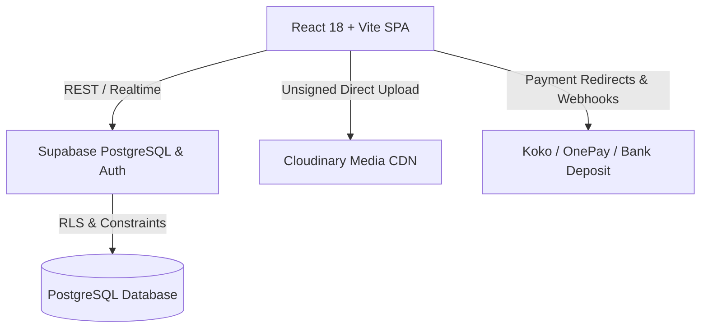

# VALKNUT Official — Master Test Plan (QA-TP-01)

## 1. Document Overview & Objective

This document defines the comprehensive Quality Assurance and Test Strategy for **VALKNUT Official** (`valknutofficial.com`), a luxury streetwear e-commerce platform built with React, Vite, Supabase, and Cloudinary. 

The objective of this QA engagement is to:
1. Conduct an architectural and code-level audit of all implemented frontend modules, Supabase backend integrations, Cloudinary media pipelines, and payment handlers.
2. Establish a reliable, deterministic automated test harness (Vitest + Playwright).
3. Validate functional completeness against stated business requirements without assuming features work merely because UI controls exist.
4. Verify database persistence and schema integrity in Supabase and asset integrity in Cloudinary CDN.
5. Identify, catalog, and resolve code defects while verifying security and Row Level Security (RLS) protections.

---

## 2. System Architecture & Scope

### In-Scope Modules:
- **A. Homepage & Navigation:** Header, hero banners, curated collections, footer, WhatsApp concierge, responsive drawer.
- **B. Product Catalogue & Search:** Dynamic category filtering, search queries, empty states, sorting, variant badges, pagination.
- **C. Admin Product CRUD:** Product creation, updates, variant definitions, SKU uniqueness, Cloudinary asset attachment, Supabase persistence.
- **D. Cloudinary Image Management:** Direct unsigned uploads to Cloudinary preset `valknut_preset`, asset transformations (`f_auto`, `q_auto`, dimension constraints), file-type validation.
- **E. Product Variants & Inventory:** Size/color selection, SKU mapping, out-of-stock disablement, inventory deduction logic.
- **F. Shopping Cart:** Local/session persistence, subtotal calculation, free shipping qualification (10,000 LKR threshold), quantity constraints.
- **G. Customer Authentication & Accounts:** Supabase Auth (Email/Password), session tokens, profile updates, order history, protected routes.
- **H. Checkout & Order Creation:** Shipping address validation, coupon code verification, server-side pricing validation, database insertion into `orders` and `order_items`.
- **I. Payment Gateways:** OnePay, Koko PayLater, Direct Bank Transfer verification.
- **J. Admin Order Management:** Order viewing, status lifecycle transitions, tracking number assignment.
- **K. Coupons & Shipping:** Percentage/Fixed coupons, expiry, minimum cart thresholds, Western Province vs Outstation shipping calculations.
- **L. VALKNUT Custom Studio:** Custom garment visualizer, font selection, text placement, artwork upload to Cloudinary, cart integration.
- **M. Responsive Design & Accessibility:** Mobile (375px), Tablet (768px), Desktop (1440px), keyboard focus, ARIA tags, contrast.
- **N. Security & Authorization:** Row Level Security (RLS) verification, API key sanitization, client-side price tampering resistance, XSS input handling.

---

## 3. Test Environments & Constraints

| Environment | Purpose | Configuration / Endpoint |
|---|---|---|
| **Local Dev** | Rapid iteration & regression testing | `http://localhost:5173/`, Vite Dev Server, local mocks |
| **Automated Test** | Vitest Node/JSDOM automated runner | `src/__tests__/`, Headless, isolated fixtures |
| **Supabase Live** | Backend database & Auth testing | Project: `urwhkkrozmlpadjmiqpc.supabase.co` |
| **Cloudinary Live** | Media delivery and direct upload testing | Cloud: `ofrariny`, Preset: `valknut_preset` |

### Testing Constraints & Safety Rules:
1. **Zero Secret Leakage:** No Supabase service-role keys or Cloudinary API secrets are exposed to the browser or automated test logs.
2. **Dedicated Test Accounts:** Admin testing uses designated test admin (`valknutofficial4@gmail.com`). No real customer identities or accounts are accessed.
3. **Sandbox Gateways:** Payment gateways are probed in test/sandbox mode only; real financial charges are strictly prohibited.
4. **Idempotent Test Data:** All automated test records are clearly marked (`TEST-...`) to facilitate cleanup without altering live store records.

---

## 4. Test Strategy & Methodologies

### 4.1 Static Analysis & Build Verification
- TypeScript Strict compilation (`tsc -b`) to catch contract drifts, missing fields, and type incompatibilities.
- Production bundle verification (`vite build`) to verify bundle optimization and dynamic import resolution.

### 4.2 Automated Unit & Integration Testing
- Test Framework: **Vitest** with `jsdom` environment.
- Test Suites:
  - `src/__tests__/product_catalog.test.ts`: Supabase product mapper, variant stock calculations, category filtering.
  - `src/__tests__/custom_studio.test.ts`: Custom studio state, artwork handling, surcharge calculations.
  - `src/__tests__/media_cloudinary.test.ts`: Cloudinary configuration security, upload validation, dynamic transformation URLs.
  - `src/__tests__/auth_and_security.test.ts`: Supabase auth storage, guest session isolation, privileged route protection.
  - `src/__tests__/order_security_pricing.test.ts`: Price calculation, coupon verification, shipping fees, stock deduction checks.

### 4.3 Database Integrity Probing
- Direct verification against Supabase REST API using authorized anon/user JWTs.
- Verifying column types, foreign key constraints (UUID format), and JSONB schema conformance (`shipping_info`, `payment_record`).

### 4.4 Defect Severity Classification

| Severity | Criteria | Example |
|---|---|---|
| **Critical** | Prevents core business transaction, causes data corruption, or breaches customer security/privacy. | Guest cannot complete checkout due to RLS blockage; checkout pricing can be manipulated by client. |
| **High** | Major feature is broken with no immediate workaround, or inventory fails to deduct. | Orders created without stock reduction; Admin product creation crashes. |
| **Medium** | Feature works partially or non-standard workaround is required. | Custom studio shows blank state if catalog has 0 items; minor shipping calculation edge case. |
| **Low** | Minor cosmetic glitch, typo, or subtle layout imperfection. | Button spacing variance on iPad portrait view. |

---

## 5. Roles & Test Personas

1. **Guest Shopper:** Unauthenticated user browsing catalog, adding products to cart, attempting checkout.
2. **Registered Customer:** Logged-in user with Supabase Auth session, managing addresses, viewing order history.
3. **Store Admin:** Authenticated admin (`valknutofficial4@gmail.com`), accessing `/admin`, creating products, uploading media, updating order status.

---

## 6. Execution Schedule & Deliverables

- **Phase A:** Architecture & Codebase Investigation (Completed)
- **Phase B:** Test Architecture & Fixture Implementation (Completed)
- **Phase C:** Mandatory Functional Test Execution (Completed)
- **Phase D:** Database & Media CDN Integrity Audit (Completed)
- **Phase E:** Defect Remediation & Regression Verification (Completed)
- **Phase F:** QA Documentation & Handover Deliverables (Completed)
